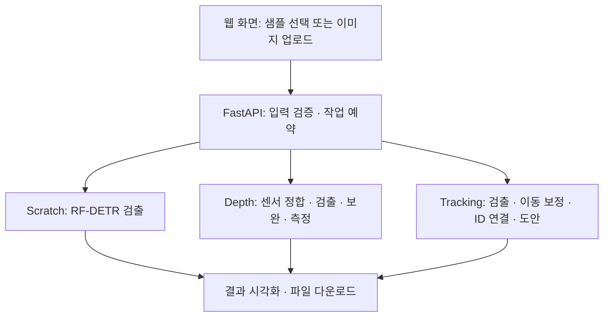

# AICP Revivo

**AICP Revivo**는 차량 파손 분석을 하나의 웹 화면에서 체험하는 프로젝트입니다. 이미지에서 스크래치를 찾는 **AICP-Scratch**, RGB와 센서 깊이로 파손의 크기·깊이를 측정하는 **AICP-Depth**, 영상에서 반복 검출되는 파손을 연결하는 **VR-MCDT**의 구현을 통합했습니다.

사용자는 샘플을 선택하거나 이미지를 업로드하고, 분석 설정을 조절한 뒤 결과를 확인할 수 있습니다. 검출은 서버의 RF-DETR 가중치로 수행하며, 검출 박스·파손 ID·측정값과 함께 결과 파일을 제공합니다.

## ✨ 세 가지 분석 기능

| 기능 | 입력 | 처리 과정 | 확인할 수 있는 결과 |
| :--- | :--- | :--- | :--- |
| 🔍 **Scratch Detection** | 기본 샘플 또는 업로드 이미지 | RF-DETR scratch 모델로 검출 | 파손 박스, 신뢰도, 원본 좌표, JSON |
| 📏 **Depth Measurement** | 제공된 RGB·센서 Depth·보정 JSON | 깊이 정합 → RGB 검출 → Marigold-DC 결측 보완 → 기하 측정 | 너비·높이·박스 면적·함몰 깊이, 전후 깊이맵, NPY |
| 🎞️ **Damage Tracking** | 제공된 차량 영상 | 두 모델 검출 → 수평 이동 보정 → 동일 파손 ID 연결 | 파손별 대표 프레임, 확정 ID 수, 박스 영상, 차량 도안 |

### Scratch Detection

JPG·PNG·WebP 이미지를 선택하고 신뢰도를 조절합니다. 모델 입력 과정에서 바뀐 크기와 패딩을 역변환하여, 결과 박스를 **원본 이미지 좌표**로 돌려줍니다. EXIF 회전도 입력에 반영합니다.

### Depth Measurement

센서 Depth를 RGB 카메라 좌표에 정합하고, Marigold-DC로 결측 영역을 보완합니다. **이미 관측된 센서 깊이는 유지**하며 RGB에서 새로 검출한 파손 박스를 측정합니다. 측정 근거가 부족하면 값 대신 `null`과 사유를 반환합니다.

### Damage Tracking

차량 이동으로 달라진 검출 위치를 보정한 뒤, 같은 파손을 프레임 간 연결합니다. 기본적으로 모든 원본 프레임을 분석하며, **2회 이상 관측된 ID**만 확정 파손 수에 포함합니다. 화면에서는 원본 재생본·분석 영상·차량 도안을 확인할 수 있습니다.

<strong>🖼️ 차량 도안 보기</strong>

| 왼쪽 · CAM4 / CAM5 | 위쪽 · CAM3 / CAM6 | 오른쪽 · CAM1 / CAM2 |
| :---: | :---: | :---: |
|  |  |  |

프로젝트가 사용하는 기본 도안입니다. 분석 후에는 확정 파손 ID의 위치를 점으로 표시합니다. 기본 설정의 위치는 **근사 투영**이며, 점의 크기는 실제 파손 크기가 아닙니다.

## 🧠 처리 흐름

- **검출:** scratch와 dent의 체크포인트 구조를 각각 검사하고 맞는 모델 클래스를 선택합니다.
- **추적:** 광학 흐름으로 수평 이동을 추정하고, 보정 좌표에서 Hungarian 알고리즘으로 일대일 연결합니다.
