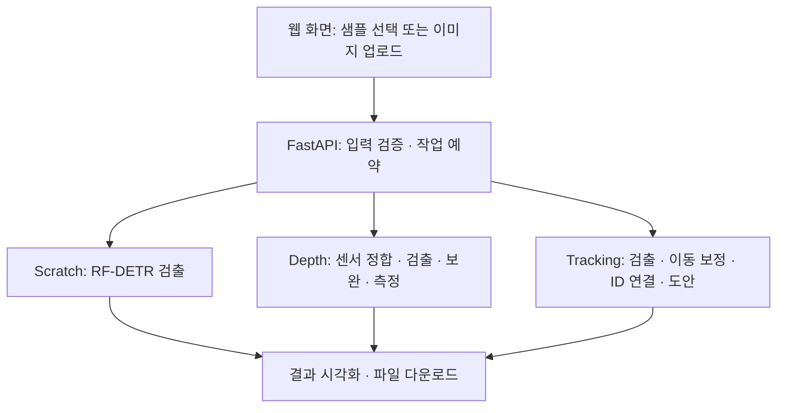

# AICP Revivo

<a id="overview"></a>

**AICP Revivo**는 차량 파손 분석을 하나의 웹 화면에서 체험하는 프로젝트입니다. 이미지에서 스크래치를 찾는 **AICP-Scratch**, RGB와 센서 깊이로 파손의 크기·깊이를 측정하는 **AICP-Depth**, 영상에서 반복 검출되는 파손을 연결하는 **VR-MCDT**의 구현을 통합했습니다.

사용자는 샘플을 선택하거나 이미지를 업로드하고, 분석 설정을 조절한 뒤 결과를 확인할 수 있습니다. 검출은 서버의 RF-DETR 가중치로 수행하며, 검출 박스·파손 ID·측정값과 함께 결과 파일을 제공합니다.

<a id="features"></a>

## ✨ 세 가지 분석 기능

| 기능 | 입력 | 처리 과정 | 확인할 수 있는 결과 |
| :--- | :--- | :--- | :--- |
| 🔍 **Scratch Detection** | 기본 샘플 또는 업로드 이미지 | RF-DETR scratch 모델로 검출 | 파손 박스, 신뢰도, 원본 좌표, JSON |
| 📏 **Depth Measurement** | 제공된 RGB·센서 Depth·보정 JSON | 깊이 정합 → RGB 검출 → Marigold-DC 결측 보완 → 기하 측정 | 너비·높이·박스 면적·함몰 깊이, 전후 깊이맵, NPY |
| 🎞️ **Damage Tracking** | 제공된 차량 영상 | 두 모델 검출 → 수평 이동 보정 → 동일 파손 ID 연결 | 파손별 대표 프레임, 확정 ID 수, 박스 영상, 차량 도안 |

### Scratch Detection

JPG·PNG·WebP 이미지를 선택하고 신뢰도를 조절합니다. 모델 입력 과정에서 바뀐 크기와 패딩을 역변환하여, 결과 박스를 **원본 이미지 좌표**로 돌려줍니다. EXIF 회전도 입력에 반영합니다.

### Depth Measurement

센서 Depth를 RGB 카메라 좌표에 정합하고, Marigold-DC로 결측 영역을 보완합니다. **이미 관측된 센서 깊이는 유지**하며 RGB에서 새로 검출한 파손 박스를 측정합니다. 측정 근거가 부족하면 값 대신 `null`과 사유를 반환합니다.

### Damage Tracking

차량 이동으로 달라진 검출 위치를 보정한 뒤, 같은 파손을 프레임 간 연결합니다. 기본적으로 모든 원본 프레임을 분석하며, **2회 이상 관측된 ID**만 확정 파손 수에 포함합니다. 화면에서는 원본 재생본·분석 영상·차량 도안을 확인할 수 있습니다.

<details>
<summary><strong>🖼️ 차량 도안 보기</strong></summary>

| 왼쪽 · CAM4 / CAM5 | 위쪽 · CAM3 / CAM6 | 오른쪽 · CAM1 / CAM2 |
| :---: | :---: | :---: |
|  |  |  |

프로젝트가 사용하는 기본 도안입니다. 분석 후에는 확정 파손 ID의 위치를 점으로 표시합니다. 기본 설정의 위치는 **근사 투영**이며, 점의 크기는 실제 파손 크기가 아닙니다.

</details>

<a id="pipeline"></a>

## 🧠 처리 흐름



- **검출:** scratch와 dent의 체크포인트 구조를 각각 검사하고 맞는 모델 클래스를 선택합니다.
- **추적:** 광학 흐름으로 수평 이동을 추정하고, 보정 좌표에서 Hungarian 알고리즘으로 일대일 연결합니다.
- **깊이:** 검출 모델을 메모리에서 해제한 뒤 Marigold를 실행하고, 센서 관측값을 보존하여 결과를 구성합니다.
- **실행:** CUDA를 사용할 수 있으면 GPU를 선택합니다. 지원되는 GPU 실행 오류는 CPU에서 재시도하고 결과에 알립니다.

알고리즘의 수식·의사코드·설계 근거는 [VR-MCDT 기술 보고서](docs/vr-mcdt-paper.md)에 설명되어 있습니다.

<a id="quickstart"></a>

## 🚀 빠른 시작

### 1. 실행 환경과 가중치 준비

Python **3.12**와 Git LFS를 권장합니다. 다음은 Bash 기준 실행 명령입니다.

```bash
git lfs install
git clone https://github.com/Moon-Dongkyu/AICP-revivo.git
cd AICP-revivo
git lfs pull
python -m venv .venv
source .venv/bin/activate
pip install -r requirements.txt
```

아래 두 파일이 실제 모델 파일로 준비되어 있어야 합니다. Git LFS 포인터만 내려받은 상태라면 `git lfs pull`을 먼저 실행하세요.

```text
weights/
├── scratch.pth
└── dent.pth
```

### 2. 기본 샘플 접근 권한 설정

샘플은 [Hugging Face 비공개 데이터셋](https://huggingface.co/datasets/dkcns/AICP-revivo)에서 내려받습니다. 해당 데이터셋을 읽을 수 있는 계정으로 인증합니다.

```bash
hf auth login
```

환경변수 `HF_TOKEN`을 사용하는 방법도 지원합니다. 직접 업로드한 Scratch 이미지 분석에는 데이터셋 접근 권한이 필요하지 않습니다. 첫 Depth 분석에서는 Marigold 모델 다운로드도 필요합니다.

### 3. 서버 실행

```bash
uvicorn revivo.app:app --host 0.0.0.0 --port 7860 --workers 1
```

**👉 [http://localhost:7860](http://localhost:7860)** 에서 샘플 선택 → 설정 조절 → **AI 분석 / 크기·깊이 측정** 순서로 실행합니다.

> **실행 프로세스는 1개로 유지하세요.** 모델과 작업 상태를 프로세스 메모리에서 관리합니다. 한 번에 한 건을 처리하며, 진행 중 다른 분석 요청에는 `429`를 반환합니다.

<a id="structure"></a>

## 🗂️ 프로젝트 구성

```text
AICP-revivo/
├── revivo/                     # Python 애플리케이션
│   ├── app.py                  # HTTP API · 작업 조회/취소/만료
│   ├── inference.py            # RF-DETR 로딩 · 이미지/영상 추론
│   ├── samples.py              # 데이터셋 카탈로그 · 다운로드 · 미리보기
│   ├── depth/                  # RGB-D 정합 · 깊이 보완 · 기하 측정
│   │   ├── pipeline.py
│   │   ├── completion.py
│   │   ├── marigold_dc.py
│   │   ├── rgbd.py
│   │   ├── measurements.py
│   │   ├── damage_depth.py
│   │   └── Marigold-LICENSE.txt
│   └── tracking/               # VR-MCDT에서 재사용한 추적 구현
│       ├── core.py             # OR-MCDT 좌표 보정 · ID 연결
│       ├── motion.py           # 품질 기준을 적용한 광학 흐름
│       ├── checkpoint.py       # 가중치 구조 · 로딩 검증
│       ├── blueprint.py        # 확정 파손의 도안 투영
│       ├── blueprint_cameras.json
│       └── storage.py
├── static/                     # HTML · CSS · JavaScript
│   └── assets/                 # 차량 도안 · 아이콘 · 폰트 · 라이선스
├── weights/                    # 비공개 모델 가중치, Git LFS
├── docs/                       # 구조 · 사용 · 배포 · 기술 보고서
├── .github/workflows/           # GitHub → Hugging Face 동기화
├── Dockerfile
├── requirements.txt
└── README.md
```

주요 파일을 표시한 트리이며 Python 패키지의 `__init__.py`와 숨김 설정 파일은 생략했습니다. 로컬 `samples/`와 `.venv/`는 Git·Docker 대상에서 제외합니다. 모듈별 책임과 파일 배치 기준은 [소스 구조 문서](docs/architecture.md)를 참고하세요.

## 🛠️ 기술 구성

| 영역 | 사용 기술 | 역할 |
| :--- | :--- | :--- |
| 웹 API | FastAPI · Uvicorn | 입력 검증, 비동기 작업 상태, 결과 제공 |
| 프런트엔드 | HTML · CSS · JavaScript · Canvas | 파일 미리보기, 검출·측정 결과, 영상과 도안 표시 |
| 검출 | RF-DETR `1.10.0` · PyTorch | scratch/dent 가중치 기반 로컬 추론 |
| 깊이 | Marigold-DC · Diffusers · NumPy | 센서 관측으로 유도하는 깊이 보완과 기하 계산 |
| 추적 | OpenCV · OR-MCDT | 광학 흐름, 좌표 보정, 일대일 연결 |
| 데이터 | Hugging Face Hub | 리비전을 고정한 샘플·모델 다운로드와 캐시 |
| 배포 | Docker · Hugging Face Spaces · GitHub Actions | 컨테이너 실행과 소스 동기화 |

프런트엔드 빌드 단계나 외부 CDN 없이 웹 UI를 제공합니다. 정확한 실행 의존성 범위는 [requirements.txt](requirements.txt)에 있습니다.

<details>
<summary><strong>⚙️ 환경변수와 기본 분석 설정</strong></summary>

| 환경변수 | 기본값 | 설명 |
| :--- | :--- | :--- |
| `HF_TOKEN` | 없음 | 비공개 데이터셋 읽기 인증 |
| `REVIVO_DEVICE` | `auto` | `auto` · `cpu` · `cuda` |
| `REVIVO_CPU_THREADS` | CPU 수와 4 중 작은 값 | PyTorch CPU 스레드 수 |
| `REVIVO_MARIGOLD_PATH` | 고정 Hub 모델 | 로컬 Marigold 모델 디렉터리 |

| 분석 설정 | 웹/API 기본값 |
| :--- | :--- |
| 검출 신뢰도 | `0.5` |
| Tracking 프레임 선택 | 전체 프레임; `sample_fps` 지정 시 선택적으로 샘플링 |
| Tracking 연결 조건 | 보정 중심 거리 `25px` **또는** IoU `0.1` 이상 |
| Tracking 파손 확정 | 최소 `2회` 관측 |
| Marigold 처리 | `10단계`, `256px` |
| 깊이 측정 설정 | `noise_mm=2`, `coverage=0.9` |

`coverage`는 측정 판정에 사용하는 설정값이며 통계적 신뢰수준을 뜻하지 않습니다. 모델·설정·처리 제한의 상세 의미는 [사용 안내](docs/usage.md)를 참고하세요.

</details>

## 🔌 API 한눈에 보기

| 요청 | 용도 |
| :--- | :--- |
| `GET /api/samples` | 사용 가능한 샘플 조회 |
| `POST /api/samples/{sample_id}/jobs` | `scratch` · `depth` · `tracking` 샘플 분석 |
| `POST /api/jobs/{demo}` | 이미지 또는 영상 원문 업로드: `scratch` · `tracking` |
| `GET /api/jobs/{id}` | 진행 상태와 결과 조회 |
| `DELETE /api/jobs/{id}` | 진행 중 분석 취소 또는 완료 결과 삭제 |
| `GET /api/jobs/{id}/media/{filename}` | 허용된 결과 파일 다운로드 |
