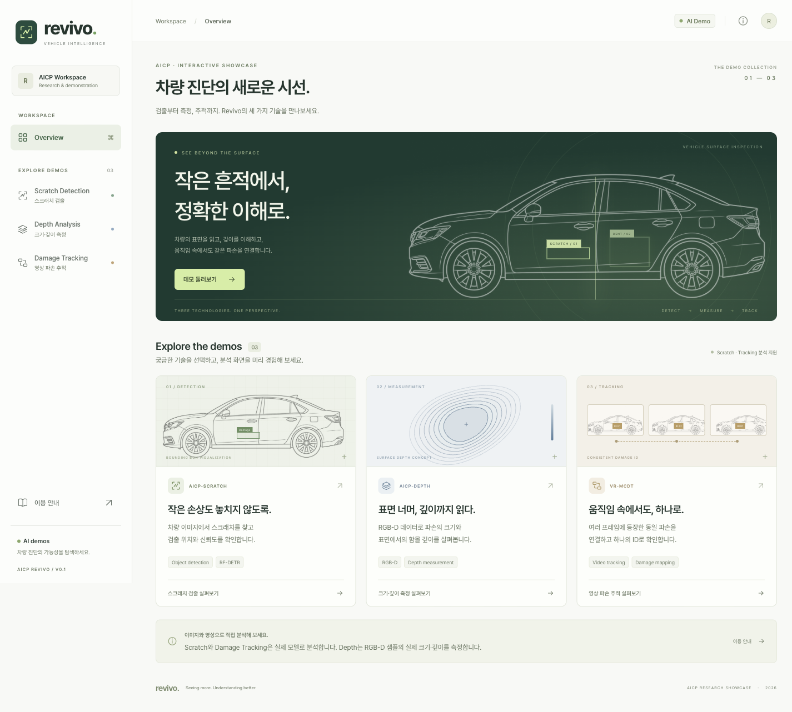

# AICP Revivo

## 🚀 [지금 데모 체험하기 →](https://dkcns-aicp-revivo.hf.space/)

**설치 없이 브라우저에서 차량 파손 검출·크기와 깊이 측정·영상 추적을 직접 체험해 보세요.**

*공개 데모의 실제 첫 화면입니다. 위 이미지나 [데모 링크](https://dkcns-aicp-revivo.hf.space/)를 누르고, 체험할 기술을 선택하세요.*

## 프로젝트 소개

**AICP Revivo는 차량 외관의 스크래치와 덴트를 분석하기 위해 촬영 환경, RGB-D 데이터 수집, 데이터셋 구축, AI 검출·측정·추적을 연결하는 연구·개발 프로젝트입니다.**

차량 표면에서 파손을 찾는 것부터 파손의 크기와 함몰 깊이를 측정하고, 영상에 반복 등장하는 같은 파손을 연결하는 것까지 다룹니다. 촬영 장비와 조명, 데이터 품질, 모델 학습과 평가, 분석 결과 확인을 함께 연구하여 차량 외관 상태를 일관된 근거로 파악하는 것을 목표로 합니다.

공개 데모는 프로젝트의 핵심 분석 기술을 직접 살펴볼 수 있는 체험 공간입니다. 프로젝트의 개발·연구 과정은 [개발·연구 이력](history.md)에 정리되어 있습니다.

## 프로젝트가 다루는 세 가지 질문

| 질문 | 핵심 기술 | 확인하려는 정보 |
| :--- | :--- | :--- |
| **어디에 파손이 있는가?** | 스크래치·덴트 검출 | 차량 이미지 속 파손 위치와 유형 |
| **얼마나 크고 깊은가?** | RGB-D 기반 기하 측정 | 파손의 너비·높이와 정상 표면 대비 함몰 깊이 |
| **여러 번 보이는 파손이 같은 것인가?** | 영상 내 파손 추적 | 프레임 사이의 동일 파손 연결과 ID |

이 세 가지 분석을 통해 파손의 **위치·규모·동일성**을 함께 이해하는 것이 프로젝트의 핵심 방향입니다.

## 연구·개발 범위

| 영역 | 주요 내용 |
| :--- | :--- |
| **촬영 환경과 하드웨어** | LED 광원·구조광, 다중 카메라 구성, RealSense 깊이 카메라 설정과 보정 정보 연구 |
| **데이터 수집과 관리** | 차량 RGB·Depth·IR 데이터 수집·추출, 차량 세션과 메타데이터 관리, 누락·품질 확인 |
| **데이터셋 구축** | 스크래치·덴트 라벨링 기준, 학습·검증 데이터 구성과 사전 검사 |
| **AI 분석** | 파손 검출 모델 학습·평가, RGB-D 정합과 깊이 보완, 크기·깊이 측정, 영상 파손 추적 |
| **결과 확인과 연구 기록** | 검출·측정·추적 결과 시각화, 분석 도구와 데모, 기술 문서와 실험·개발 이력 정리 |

전체 흐름은 **촬영·수집 → 정제·라벨링 → 학습·평가 → 검출·측정·추적 → 결과 검토**로 이어집니다. 위 표는 프로젝트의 연구·개발 범위이며, 각 구성 요소의 구현 상태와 검증 범위는 [이력 문서](history.md)에서 구분해 기록합니다.

## 데모에서 체험할 수 있는 핵심 기술

| 기술 | 체험 내용 | 주요 결과 |
| :--- | :--- | :--- |
| **AICP-Scratch · 스크래치 검출** | 샘플 또는 업로드한 차량 이미지에서 RF-DETR로 스크래치 검출 | 파손 박스와 검출 신뢰도 |
| **AICP-Depth · 크기·깊이 측정** | 제공된 RGB-D 샘플의 센서 깊이를 정합하고, Marigold-DC로 결측을 보완하여 파손 측정 | 너비·높이·검출 박스 면적·함몰 깊이와 깊이맵 |
| **VR-MCDT · 영상 파손 추적** | 차량 이동에 따른 위치 변화를 보정하고, 여러 프레임에 나타난 동일 파손 연결 | 파손 ID, 대표 프레임, 추적 영상과 차량 도안 |

[데모 열기](https://dkcns-aicp-revivo.hf.space/) → **기술 선택** → **샘플 선택 또는 이미지 업로드** → **분석 실행** → **결과 확인** 순서로 체험할 수 있습니다. 이미지 업로드는 Scratch에서, Depth와 Tracking은 제공된 샘플로 시작하세요.

## 현재 단계와 결과 해석

프로젝트는 데이터 수집 도구, AI 학습·추론 코드, 분석 데모와 연구 산출물을 함께 발전시키는 단계입니다. 기능 구현과 데모 제공은 정량 성능이나 실제 운영 환경에서의 검증 완료를 뜻하지 않습니다.

- **검출·측정 성능:** 추적 정확도와 실측 오차는 별도 평가가 필요하며, 근거가 부족한 측정값은 제공되지 않을 수 있습니다.
- **깊이와 면적:** 깊이맵의 색상은 카메라와의 거리입니다. 함몰 깊이는 정상 표면을 기준으로 따로 측정하며, 면적은 파손 윤곽이 아닌 검출 박스 기준입니다.
- **추적 범위:** 파손 ID는 카메라별 결과입니다. 카메라 사이의 동일 파손 재식별·중복 병합은 포함하지 않으므로, 여러 카메라의 개수를 차량 전체 고유 파손 수로 합산할 수 없습니다.
- **차량 도안:** 파손 위치는 근사 투영이며, 표시된 점의 크기가 실제 파손 크기를 뜻하지 않습니다.

## 개발·연구 이력

**[개발·연구 이력 보기 →](history.md)**

촬영 장비와 RGB-D 수집 도구, 데이터셋·라벨링, AI 모델, 분석 화면과 연구 문서의 변화를 날짜와 분야별로 확인할 수 있습니다. 확인된 변경 이력, 문서에 기재된 수행기간, 구현 날짜가 확정되지 않은 소스 현황을 구분해 정리했습니다.

이 저장소는 **프로젝트 소개와 개발·연구 이력**을 관리합니다. 실행 소스·모델 가중치·데이터셋·배포 구성은 포함하지 않으며, 분석 체험은 [공개 데모](https://dkcns-aicp-revivo.hf.space/)에서 제공합니다.
